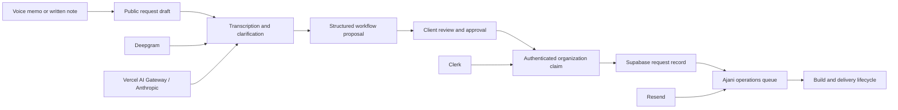

# Ajani Flow

Ajani Flow is a production web application for turning an unstructured description of a business bottleneck into a reviewable automation build brief. A client can speak or type what is slowing the business down, answer the small number of questions that materially change the solution, inspect the proposed workflow, and hand the approved request to the Ajani delivery team.

**Live product:** [ajaniflow.com](https://ajaniflow.com)

The product is intentionally not a generic drag-and-drop automation builder. It is an intake, clarification, and delivery system for done-for-you automation work: simple for the client, structured for the implementation team, and explicit about where human review remains in the loop.

## Product model

Most business owners can describe the work that is wasting time, losing leads, or creating follow-up risk, but they should not need to design the technical solution themselves. Ajani Flow separates those concerns:

1. **Capture the operational problem.** The client records a voice memo or writes a short note in ordinary language.
2. **Clarify only what changes the route.** The application identifies missing details and asks a focused batch of questions rather than presenting a long discovery form.
3. **Translate the problem into a system.** The note becomes an ordered workflow made of triggers, automated actions, decisions, and human handoffs.
4. **Keep the client in control.** The client edits and approves the proposed scope before submitting it.
5. **Create an implementation-ready handoff.** The approved brief, source note, voice memo, and account context become a durable request for the Ajani team.

This creates a clean boundary between automated interpretation and human authorization: AI can propose and structure the route, but the client approves what will actually be built.

## Core experiences

- **Marketing and education** — the home page, client proof library, interactive system preview, and automation demos explain the product without requiring an account.
- **Guided request flow** — `/record` and `/request` support voice and written intake, transcription, clarification, workflow editing, review, and submission.
- **Secure account handoff** — Clerk authentication connects an anonymous draft to the correct user and organization without discarding work completed before sign-in.
- **Client portal** — authenticated organizations can inspect submitted builds, delivery status, system activity, and billing-oriented information.
- **Internal operations** — the admin experience supports demand triage, request comparison, outreach tracking, experiment metrics, and operational follow-up.

## System architecture



### Application layer

The application uses the Next.js App Router and React Server Components for route composition, with focused client components for recording, staged workflow editing, dialogs, and interactive demonstrations. Route handlers contain the public intake, transcription, webhook, cron, and internal processing boundaries.

### Identity and tenancy

Clerk provides user authentication and organization context. Organization membership is synchronized into Supabase so application records can be associated with a durable tenant. Public drafts use scoped capability tokens until the user authenticates; the claim step then attaches the draft to the verified account and organization.

### Persistence and private media

Supabase stores request drafts, approved briefs, organizations, build events, notification jobs, webhook state, and operational metadata. Voice memos are uploaded to private storage through signed upload URLs rather than being exposed as public assets. Database migrations in `supabase/migrations` define the schema, row-level security policies, job leases, and integrity constraints.

### AI and transcription

Deepgram handles voice transcription. Clarification and workflow generation can use Vercel AI Gateway with a direct Anthropic fallback. Provider responses are treated as untrusted structured input and validated before they enter application state. Deterministic local fallbacks keep the public funnel usable when an AI provider is unavailable.

### Delivery and background work

Resend delivers internal request notifications. Durable database jobs provide retry state for transcription and notification work, while protected Vercel cron routes recover failed jobs and remove expired drafts. Clerk lifecycle events enter through a signature-verified webhook and are processed with database-backed ordering and lease state.

## Security boundaries

Security is enforced on the server and in the database rather than being delegated to UI state.

- Clerk sessions and organization membership protect authenticated routes.
- Supabase row-level security isolates tenant-owned data.
- Service-role access is restricted to trusted server modules.
- Anonymous draft capabilities are random, scoped, and stored as hashes.
- Voice recordings remain private and are accessed through short-lived signed URLs.
- Public JSON and multipart endpoints enforce request-size and rate limits.
- Webhook signatures are verified before lifecycle events are accepted.
- Admin access combines Clerk authorization, allowlists, a server-side access key, and signed session state.
- Retention workers remove expired drafts and associated private media.

## Motion and interaction design

Motion is part of the product explanation rather than decoration alone. The home system preview visualizes a note moving through interpretation and routing; page transitions preserve continuity between concepts; staged record-flow animations make state changes legible; and the demos animate signals through example automation systems.

The current product policy enables full motion at the root layout. CSS retains reduced-motion fallbacks for contexts where that override is absent. Animation behavior is covered by Playwright checks for route transitions, system-preview timelines, staged request screens, demo playback, and mobile interaction.

## Technology

- Next.js 16 and React 19
- TypeScript
- CSS Modules and application-level design tokens
- Clerk authentication and organizations
- Supabase Postgres, Row Level Security, and private Storage
- Vercel AI Gateway and Anthropic
- Deepgram transcription
- Resend transactional email
- Zod runtime validation
- Vitest unit tests and Playwright browser tests
- Vercel hosting and cron execution

## Repository layout

```text
src/
  app/                 App Router pages, layouts, route handlers, and global styles
  components/          Interactive product, portal, admin, and recording components
  lib/                 Domain logic, provider clients, validation, security, and jobs
supabase/
  migrations/          Ordered database schema, RLS, RPC, and job migrations
tests/                  End-to-end and accessibility-focused Playwright coverage
docs/                   Architecture and implementation notes
.github/workflows/      Main-branch and pull-request quality gates
vercel.json             Production cron schedule
```

## Running locally

### Requirements

- Node.js 24, matching the CI environment
- npm
- Chromium for the Playwright test suite
- Optional Clerk, Supabase, AI, transcription, and email credentials for testing integrated flows

Install dependencies and start the development server:

```bash
npm install
npm run dev -- --hostname 127.0.0.1 --port 3001
```

The local application is then available at `http://127.0.0.1:3001`. This address is only for local development; the public product is [ajaniflow.com](https://ajaniflow.com).

### Configuration

Copy `.env.example` to `.env.local` and add only the integrations needed for the flow being tested. The configuration is organized into these responsibilities:

- **Application identity** — public application URL and runtime environment
- **Authentication** — Clerk browser, server, and webhook credentials
- **Persistence** — Supabase URL, publishable key, and trusted server key
- **AI and transcription** — gateway/provider selection, Anthropic fallback, and Deepgram
- **Operations** — Resend delivery, internal recipients, admin authorization, and cron protection
- **Abuse prevention** — dedicated secrets for request fingerprints and signed sessions
- **Future billing** — Stripe values reserved for the billing phase

Do not commit `.env.local`, production credentials, service-role keys, or webhook secrets. The complete variable inventory and safe placeholders live in [`.env.example`](./.env.example).

## Quality checks

```bash
npm run lint
npm run type-check
npm run test:unit
npm run test:e2e
npm run test:database
npm run build
```

`npm run test:unit` covers domain validation and server utilities. `npm run test:e2e` launches the application and exercises public navigation, responsive layouts, accessibility regressions, recording states, workflow transitions, transcription handoff, and the permanent reliability regressions in `audit/`. No expected failures are accepted as proof of a fix.

`npm run test:database` creates an isolated native PostgreSQL 17 cluster on a random loopback port. It never loads `.env` or accepts a remote database URL. It applies the complete migration chain, runs synthetic rollback-only SQL checks, and uses independent connections to prove transaction locking. Test data is retained under the ignored `.tmp/database-tests` directory, and the server stops after the run. Minimal Supabase-owned schema contracts are bootstrapped; this does not emulate the Storage HTTP service or validate real Clerk/provider credentials.

For production-build browser verification, set `PLAYWRIGHT_PRODUCTION=1` and optionally `PLAYWRIGHT_PORT` before `npm run test:e2e`. The harness builds and runs optimized Next output using a credential-free **preview** environment; production's fail-closed authentication policy is unchanged. The standalone `npm run test:regression` command targets an already-running local server (`PLAYWRIGHT_BASE_URL` overrides its URL).

Install the browser runtime once before running Playwright locally:

```bash
npx playwright install chromium
```

The GitHub Actions workflow runs linting, generated-route type checks, unit tests, production-build browser tests, and isolated database tests for pull requests and pushes to `main`. It does not deploy or mutate a connected database.

## Production deployment

The production target is [ajaniflow.com](https://ajaniflow.com), hosted on Vercel. The intended release path is a reviewed push to `main`, followed by a production build and browser verification against the public domain.

Before releasing:

1. Review and explicitly approve the release and target database; apply pending Supabase migrations in order only after backup/recovery checks. Local development is not approval to push or deploy.
2. Confirm the Vercel production environment contains the live Clerk credential pair and all required server integrations.
3. Run the complete quality suite.
4. Verify the deployed home page, client proof library, Demos, authentication handoff, and record flow.
5. Confirm cron authorization and a plan/scheduler supporting the configured every-minute recovery and every-15-minute retention schedules. These schedules cannot run on Vercel Hobby. Inspect failed-job backlog after database or provider changes.
6. Run `npm run check:database-contract` against the explicitly configured target. This read-only check verifies required RPCs are exposed; it does not apply migrations or certify provider behavior.

The proxy deliberately fails closed in a production runtime when valid live Clerk credentials are missing. Preview and local environments can run the public experience with optional integrations disabled.

## Additional documentation

- [Architecture notes](./docs/architecture.md)
- [Engineering audit](./docs/engineering-audit-2026-09-05.md)
- [Engineering remediation and release gates](./docs/engineering-remediation-2026-09-05.md)

## Project status

Ajani Flow is an actively developed production application. The public education experience and guided request funnel are implemented; operational tooling, provider resilience, data hardening, and delivery workflows continue to evolve alongside the service.
