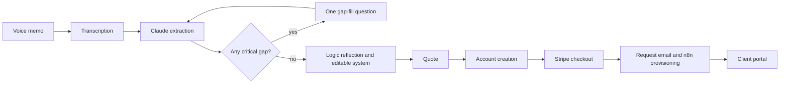

# Ajani account and portal architecture

## Product boundary

The public request flow is deliberately anonymous until a client has heard their own system reflected back and seen the scope and price. Account creation occurs directly before checkout, where the value exchange is clear: create a private account to track the request, active systems, billing, and future builds.

## Authentication model

Clerk owns sign-in, sign-up, sessions, and the account menu. `/portal`, `/portal/builds`, and write endpoints are protected by Clerk at the route boundary and within each server-rendered protected page or handler. Supabase stays responsible for relational data and private audio storage.

Configure Clerk's native Supabase integration in both dashboards. It adds the authenticated database role to Clerk session tokens, while RLS reads the Clerk user ID from `auth.jwt()->>'sub'`. Clerk does not copy users into Supabase automatically, so the account-creation or Clerk webhook step upserts the matching `profiles` row.

## Account model

`profiles` identifies a human account. `organizations` is the client business account. This distinction keeps the initial single-owner experience simple while allowing an operations manager or teammate to join later without duplicating builds, billing, or systems.

| Concern | Primary record | Notes |
| --- | --- | --- |
| Personal profile | `profiles` | Clerk user ID, name, phone, avatar |
| Business preferences | `organizations` | Business name, niche, budget signal, preferred alert channel |
| Submitted request | `build_requests` | Transcript, extraction, approved system definition, quote, lifecycle status |
| Raw audio | `voice_memos` + private Storage | Audio path, transcript, provider metadata |
| Gap-fill | `gap_questions` | Targeted question, answer, delivery channel |
| Live automation | `automation_systems`, `automation_runs` | Health, last run, error state |
| Billing | `billing_subscriptions`, `invoices` | Stripe IDs only, never payment details |

## Isolation model

Every business-owned record has an `organization_id`. Row-level security checks membership against `organization_members` using the Clerk `sub` claim; the Supabase service role is only for trusted server jobs such as profile upserts, signed audio upload, Stripe webhooks, and n8n callbacks. The full migration lives in `supabase/migrations/20260808000000_portal_foundation.sql`.

## Integration boundaries

| Stage | Owner | Input | Persisted output |
| --- | --- | --- | --- |
| Upload | Next.js server + Supabase Storage | Audio file | `voice_memos.storage_path` |
| Transcription | Whisper or ElevenLabs STT | Storage path | Transcript and duration |
| Extraction | Claude API | Transcript | Summary, gaps, suggested blocks |
| Gap-fill | Next.js + Twilio or email | One missing decision | `gap_questions.answer` |
| Quote | Pricing service | Reflected system | Quote amount and tier |
| Payment | Stripe | Build request ID | Checkout session and payment event |
| Provisioning | n8n | Paid request event | System config or human task |
| Internal queue | Resend or Postmark | Structured request summary | Staff notification with portal link |

Each boundary should be idempotent. `build_events` records inbound callbacks and state transitions so a retry cannot silently duplicate a notification, charge, or provisioning job.

## Portal routes

- `/` public marketing site
- `/request` anonymous value-first request flow
- `/sign-in` Clerk sign-in entry point
- `/sign-up` Clerk account creation entry point
- `/portal` active systems, health, monthly usage, and cost visibility
- `/portal/builds` request history and status
- `/api/build-requests` authenticated build-request persistence endpoint

## What needs credentials before it becomes live

1. Clerk publishable and secret keys, sign-in methods, redirect URLs, and the native Supabase integration.
2. Supabase project URL, publishable key, and service-role key.
3. Stripe products and webhook secret.
4. Claude, transcription, Twilio, and n8n webhook credentials.
5. A signed internal webhook policy for n8n and idempotency keys for Stripe callbacks.
