# Ajani Flow architecture

## Product boundary

Ajani Flow converts an unstructured business problem into an approved automation build request. The public experience is deliberately useful before authentication: a visitor can provide a voice or written note, clarify the details that affect the route, and inspect the proposed system. Authentication happens when the visitor saves or submits that work to the private client account.

The application does not autonomously deploy business automations. Its responsibility ends at a durable, client-approved implementation brief and the operational records used by the Ajani delivery team.

```mermaid
flowchart LR
  A[Voice or written note] --> B[Anonymous request draft]
  B --> C[Transcription]
  C --> D[Demand classification]
  D --> E[Focused clarification]
  E --> F[Structured workflow proposal]
  F --> G[Client edits and approval]
  G --> H[Clerk authentication]
  H --> I[Draft claim and submission]
  I --> J[Organization build request]
  J --> K[Internal notification and review]
  K --> L[Delivery lifecycle]
```

## Runtime composition

Ajani Flow is a Next.js App Router application deployed to Vercel.

- Server Components render marketing, portal, legal, and internal operations surfaces.
- Client Components own recording, staged workflow editing, dialogs, interactive demonstrations, and browser persistence.
- Route Handlers define the public intake, AI, transcription, webhook, and cron boundaries.
- Supabase provides Postgres persistence, database functions, row-level security, and private object storage.
- Clerk provides browser sessions, users, and organization context.
- External providers are isolated behind server-only modules in `src/lib`.

## Request lifecycle

### 1. Browser-local composition

The record flow begins as browser state. Voice capture, typed notes, clarification answers, and workflow edits remain local until the visitor elects to save or submit. This keeps the first interaction fast and prevents incomplete experiments from automatically becoming operational records.

### 2. Public draft creation

`POST /api/request-drafts` validates the note and workflow, creates a random capability token, stores only its hash, and returns a scoped draft reference. If a voice memo is present, the response also contains a signed Supabase Storage upload target.

The raw capability token is held by the browser. Possession permits access only to the corresponding draft; it is not an account session and does not grant organization access.

### 3. Voice upload and transcription

The browser uploads audio directly to private Supabase Storage, then calls the voice-completion route. A database-backed transcription job leases the memo to a worker, which submits it to Deepgram and records provider metadata, transcript state, retry timing, and terminal errors.

The direct `/api/transcribe-voice` route supports the immediate pre-save transcription experience. The durable storage-backed path remains the source of truth after a draft is saved.

### 4. AI interpretation

The workflow service generates structured clarification and automation blocks through Vercel AI Gateway, with direct Anthropic as an optional fallback. Zod validates provider output before it reaches client or database state. Local deterministic rules provide a final fallback for provider outages.

Demand classification is recorded separately from workflow generation so operational triage can evolve without changing the client-approved system definition.

### 5. Authentication and claim

Clerk owns sign-in, sign-up, sessions, and organizations. After authentication, the browser submits its draft capability to `/api/request-drafts/claim`. The server verifies the token hash, provisions or resolves organization context, and invokes a database function that atomically associates the draft with the authenticated identity.

### 6. Submission and operations

Submission copies the approved client state into `build_requests`, preserves the source draft and voice-memo relationships, appends lifecycle events, and enqueues an internal notification job. Resend delivers the operational handoff, while the admin surface provides demand, experiment, and outreach tooling.

## Identity and tenant isolation

`profiles` represents a human identity. `organizations` represents the client business. `organization_members` connects the two with owner or member roles.

Every tenant-owned record carries an `organization_id`. Supabase RLS helpers read the Clerk subject and active organization claims from the authenticated JWT, then enforce membership or ownership. The service role is reserved for trusted server paths such as webhook synchronization, signed storage operations, job workers, and admin aggregation.

Clerk lifecycle events are accepted only after signature verification. Database-backed event rows provide ordering, lease, completion, and error state for profile, organization, and membership synchronization.

## Persistence model

| Area | Primary records | Purpose |
| --- | --- | --- |
| Identity | `profiles`, `organizations`, `organization_members` | Clerk-synchronized people, businesses, and roles |
| Intake | `request_drafts`, `request_draft_ai_states`, `request_draft_ai_runs` | Anonymous and pre-submission work |
| Clarification | `request_draft_gap_questions`, `gap_questions` | Questions whose answers change the proposed route |
| Delivery | `build_requests`, `build_request_quotes`, `build_events` | Approved scope, commercial state, and lifecycle history |
| Voice | `voice_memos`, `voice_memo_transcription_jobs` | Private media references and durable transcription work |
| AI audit | `build_request_ai_states`, `ai_workflow_runs` | Provider attempts and structured generation state |
| Systems | `automation_systems`, `automation_runs` | Delivered-system status and execution history |
| Operations | `build_request_notification_jobs`, `admin_activity_log` | Staff handoff, retries, and privileged activity |
| Experiments | `outreach_experiments`, `outreach_variants`, `outreach_batches`, `outreach_batch_metrics` | Internal demand and outreach measurement |
| Billing model | `billing_subscriptions`, `invoices`, `pricing_modules` | Future commercial lifecycle and deterministic pricing records |

Stripe SDK support and billing tables are present, but checkout is not part of the current public submission path.

## External service boundaries

| Boundary | Direction | Responsibility |
| --- | --- | --- |
| Clerk | inbound and outbound | Sessions, organizations, management API provisioning, signed lifecycle webhooks |
| Supabase | bidirectional | Relational state, RLS, RPCs, job leases, private voice storage |
| Deepgram | outbound | Voice transcription and provider metadata |
| Vercel AI Gateway | outbound | Primary structured workflow and demand-model routing |
| Anthropic | outbound | Optional direct model fallback |
| Resend | outbound | Idempotent internal request notification delivery |
| Vercel Cron | inbound | Authenticated retry and retention invocations |

Provider clients return normalized application errors. Durable work records separate retryable failures from terminal failures, and leases prevent ordinary concurrent workers from claiming the same job.

## Route surface

### Public pages

- `/` — product explanation and system preview
- `/demos` — interactive automation examples
- `/stories` — business-specific automation narratives
- `/approach` — delivery approach
- `/record` — guided intake and approval flow (`/request` is a permanent redirect to it, in `next.config.ts`)
- `/legal`, `/terms`, and `/privacy` — policy surfaces

### Authenticated pages

- `/portal` — organization overview
- `/portal/builds` and `/portal/builds/[buildId]` — request history and detail
- `/portal/systems` — delivered automation systems
- `/portal/billing` — billing-oriented account surface
- `/admin` — allowlisted internal operations

### Server routes

- `/api/automation-brief` — clarification and structured workflow generation
- `/api/transcribe-voice` — immediate transcription
- `/api/request-drafts` — draft creation and signed upload preparation
- `/api/request-drafts/[draftId]` — capability-scoped draft access
- `/api/request-drafts/[draftId]/voice-memo/complete` — upload completion and transcription enqueue
- `/api/request-drafts/claim` — authenticated capability claim and submission
- `/api/webhooks/clerk` — signed identity synchronization
- `/api/cron/process-intake-jobs` — transcription and notification recovery
- `/api/cron/delete-expired-drafts` — draft and private-media retention
- `/api/cron/send-build-notifications` — notification batch worker

## Motion architecture

Motion is implemented with CSS keyframes, CSS Modules, application design tokens, and small React state machines. The root `data-motion` policy coordinates route transitions, scroll reveals, system-preview choreography, recorder feedback, workflow stages, and interactive demos. Reduced-motion media rules provide a non-animated fallback whenever full motion is not explicitly selected.

Browser tests exercise both the full-motion policy and fallback behavior so CSS compilation, hydration, and route navigation are covered together.

## Operational invariants

- Production fails closed when a valid live Clerk credential pair is unavailable.
- Public draft tokens are never stored in plaintext.
- Voice objects remain in private storage and use time-limited signed access.
- AI output is validated before persistence or rendering.
- Background work is leased and records attempt, retry, and terminal state.
- Notification delivery uses a stable idempotency key per build request.
- Tenant access is checked server-side and through database policy.
- Expired drafts and their associated media are removed by the retention worker.

## Deployment model

`main` is the production source branch. GitHub Actions runs linting, generated-route type checks, unit tests, an optimized Next.js build, and Playwright browser coverage. Vercel builds the production artifact and assigns it to [ajaniflow.com](https://ajaniflow.com).

Database migrations are intentionally separate from the web build. They must be applied in filename order before application code that depends on the new schema is promoted. Production verification should cover the public pages, motion policy, Clerk handoff, request persistence, private voice upload, and worker authorization.
